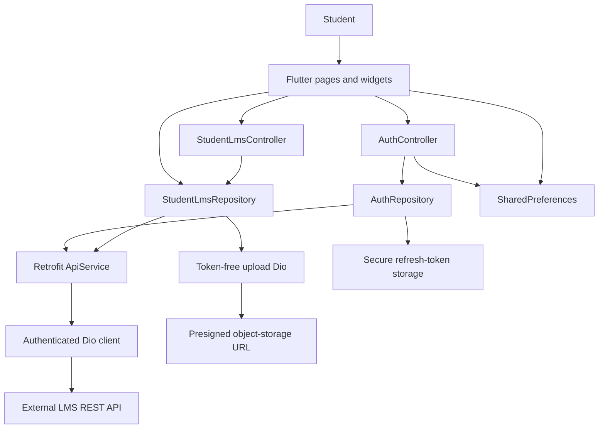
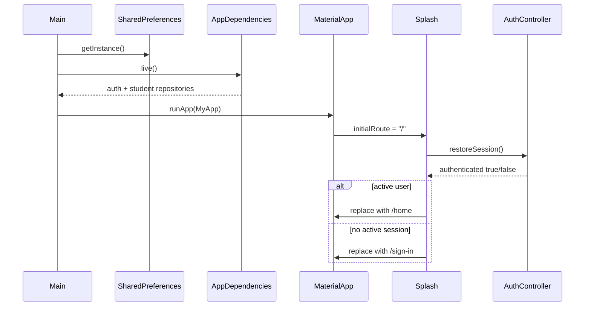
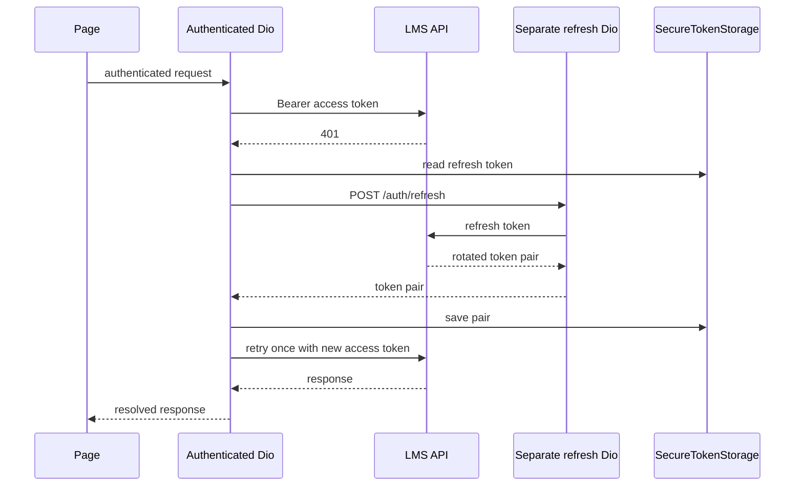
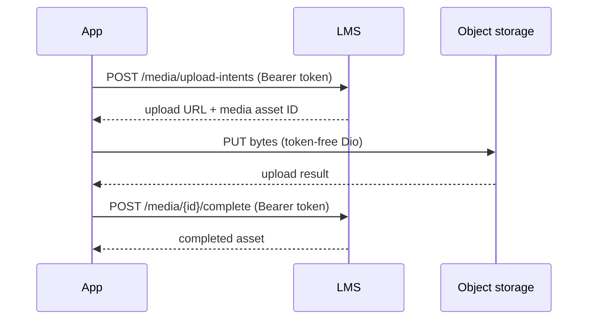

# Application architecture

## 1. Architecture summary

The app is a single Flutter client organized by feature, with shared core
services and a small domain layer. `Provider` supplies controllers and
repositories, Freezed models immutable request/response data, Retrofit defines
the HTTP interface, and Dio performs transport and authentication interception.

The repository contains no backend, database, queue, object-storage service, or
LiveKit server. Those are external systems inferred only through the client
contract.



## 2. Runtime composition

`main()` is the production composition root:

1. Initialize Flutter bindings.
2. Open `SharedPreferences`.
3. Build `AppDependencies.live()`.
4. Construct `MyApp` with `LocalStorage`, `RemoteAuthRepository`, and
   `StudentLmsRepository`.
5. Register providers.
6. Build `MaterialApp` with theme, locale, and named routing.

`MyApp` accepts nullable live repositories. Omitting them selects
`MockAuthRepository` and mock course data. This constructor-level dependency
switch is used by widget tests and local UI previews; production `main()` always
uses live dependencies.

### Provider graph

| Provider | Lifetime | Responsibility |
| --- | --- | --- |
| `ThemeController` | App | Read, toggle, and persist light/dark mode |
| `LocaleController` | App | Read, change, and persist Bengali/English locale |
| `AuthController` | App | Authentication state, loading/error state, remembered email, active user |
| `StudentLmsRepository?` | App | Direct feature operations needed by stateful pages |
| `StudentLmsController` | App | Shared course/student lists, dashboard state, loading/error partitions |

## 3. Source layout

```text
lib/
├── main.dart                         # Composition root and MaterialApp
├── core/
│   ├── auth/                         # Repository contract and secure tokens
│   ├── error/                        # AppException and API error mapping
│   ├── network/                      # Dio, Retrofit, DTOs, dependency graph
│   ├── routing/                      # Route names and page factory
│   ├── storage/                      # SharedPreferences wrapper
│   └── theme/                        # Color tokens and Material themes
├── features/
│   ├── authentication/               # Auth DTOs, repositories, controller, pages
│   ├── home/                         # Shared student repository/controller and home
│   ├── courses/                      # Catalog and course details
│   ├── learning/                     # Enrollment UI, lesson player, progress tracker
│   ├── assessments/                  # Quiz, exam, assignment flows
│   ├── live_class/                   # Live list and credential page
│   ├── payments/                     # Development checkout and history
│   ├── results/                      # Academic results
│   ├── notifications/                # Notification center
│   └── profile/                      # Profile, certificate, settings pages
└── shared/
    ├── animations/                   # Reusable reduced-motion-aware motion
    ├── localization/                 # Runtime translation catalog and locale state
    ├── models/                       # AppUser, Course, modules, lessons, mock data
    └── widgets/                      # Cards, headers, fields, icons
```

Generated `*.g.dart` and `*.freezed.dart` files live beside their source models.

## 4. Layer responsibilities

### Presentation

Pages render state, perform form validation, coordinate user confirmation, and
navigate. Reusable visual pieces live under `shared/widgets`. Some highly
interaction-specific state remains local to pages—quiz question index, selected
answers, timers, video controller, selected lesson, and attachment bytes.

### Controllers

`AuthController` and `StudentLmsController` extend `ChangeNotifier`.

- `AuthController` serializes auth actions through a shared `_run` pattern and
  exposes one loading flag and one error string.
- `StudentLmsController` separates course, student-data, assessment, and
  live-class loading/error state so one feature does not block every screen.
- `loadStudentData()` performs six independent loads concurrently and preserves
  partial success.

### Repositories

Repositories are the boundary between UI-oriented behavior and transport:

- `RemoteAuthRepository` owns token lifecycle and maps auth DTOs to `AppUser`.
- `MockAuthRepository` supplies predictable preview/test behavior.
- `StudentLmsRepository` composes endpoint calls, drains cursor pagination,
  maps course DTOs to domain models, performs presigned uploads, creates
  idempotency keys, validates URLs, and normalizes Dio errors.

Several pages read `StudentLmsRepository?` directly for short-lived operations
such as starting/submitting attempts, fetching playback, or uploading a file.
Shared lists and dashboard data go through `StudentLmsController`.

### Data and transport

- `ApiService` is a Retrofit interface with 166 app-callable operations.
- `phase_one_dto.dart` contains core auth, course, learning, payment, result,
  certificate, notification, and problem-detail contracts.
- `expanded_api_dto.dart` contains the expanded dashboard, academic catalog,
  batch, live-class, assessment, exam, leaderboard, and playback contracts.
- Freezed gives immutable values, JSON serialization, equality, and `copyWith`.
- A few broadly shaped admin/teacher responses intentionally remain
  `RawJsonMap`/`ListResponseDto` because the student UI does not consume them.

## 5. Startup and navigation architecture



Navigation uses `Navigator` 1.x named routes and a central `AppRouter` switch.
Arguments are runtime type-checked. There is no declarative router, URL parser,
deep-link configuration, or route-level role guard.

The five primary pages use `IndexedStack`, retaining scroll positions and local
widget state when switching tabs.

## 6. Authentication and token architecture

### Token placement

| Value | Storage | Lifetime |
| --- | --- | --- |
| Access token | Private in-memory field on `SecureTokenStorage` | Process/session only |
| Refresh token | `flutter_secure_storage` under `auth_refresh_token` | Persists securely until logout/rejection |
| Remembered email | `SharedPreferences` | Until unchecked or storage cleared |
| Password | Never stored by app code | Request only |

### Sign-in and restore

- Sign-in saves the token pair, then fetches `/auth/me` to build the domain user.
- Restore reads the refresh token, rotates it, saves the new pair, and fetches
  `/users/me`.
- Failed parsing or sign-in clears token state.
- A `401` during restore is converted to “no session”; other failures remain
  user-visible errors.

### Authenticated `401` retry



Important controls:

- Refresh uses a separate Dio instance, preventing recursive refresh.
- Concurrent `401` responses share one in-flight refresh future.
- A request is retried no more than once using request `extra` metadata.
- Authentication endpoints that should not refresh are explicitly excluded.
- Refresh failure clears local tokens.

## 7. Network behavior

### Base URL

`API_BASE_URL` is a compile-time Dart define. Default:

```text
https://lmsservice.maxlived.net
```

It must be the origin only; all Retrofit annotations already include
`/api/v1`. Both connect and receive timeouts are 20 seconds.

### Headers and logging

The authenticated client defaults to:

```http
Accept: application/json, application/problem+json
Content-Type: application/json
```

In debug builds, logging includes only HTTP method, path, and status. Bodies,
tokens, signed upload URLs, and LiveKit credentials are not logged.

### Pagination

Student list operations use `ListResponseDto` and repeatedly request pages while
`next_cursor` is non-empty. A set of seen cursors prevents loops if the server
repeats a cursor. The mobile repository requests 100 items per page.

### Error normalization

`AppException.fromDioException` first parses RFC 7807-style problem details,
preserving:

- Human-readable title/detail.
- HTTP status.
- Request ID.
- Per-field validation errors.

It falls back to common `message`, `detail`, or `title` fields and then to
localized Bengali connection/timeout/cancel/generic messages. Repositories also
convert malformed payloads into explicit response-format errors.

### Presigned upload isolation

Assignment uploads use this flow:



Using a separate client prevents the LMS `Authorization` header from leaking to
an unrelated storage origin.

## 8. Data model architecture

### Main domain models

- `AppUser`: ID, name, email, status, roles, primary role, verification time.
- `Course`: catalog metadata, price in minor units, enrollment ID, progress,
  modules, and display helpers.
- `CourseModule`: ordered curriculum group.
- `CourseLesson`: ordered published/preview/required lesson with media/body data.

`Course.price` divides `priceMinor` by 100, and `displayPrice` assumes BDT minor
units are poisha. This financial assumption must match the backend.

### DTO families consumed by student UI

| Family | Examples |
| --- | --- |
| Authentication | login/register/token pair/profile writes |
| Catalog | course, course detail, module, lesson, academic preferences |
| Learning | enrollment, lesson progress, playback metadata and tracks |
| Dashboard | continue learning, upcoming live class, due assignment, available quiz, recommendation |
| Assessments | quiz attempt/question, exam/attempt/leaderboard, assignment/submission |
| Commerce | order and payment intent |
| Records | result, certificate, verification |
| Communication | notification and live-class credential |
| Errors/lists | problem details and cursor list response |

The app maps backend `snake_case` fields with explicit `JsonKey` annotations.
Generated serializers are part of the checked-in source tree.

## 9. Local persistence

`LocalStorage` wraps three `SharedPreferences` keys:

| Key | Type | Default | Meaning |
| --- | --- | --- | --- |
| `is_dark_mode` | bool | `false` | Theme mode |
| `remembered_email` | string | absent | Sign-in convenience only |
| `language_code` | string | `bn` | UI locale |

`LocalStorage.clearSession()` is a no-op because authentication secrets live in
`SecureTokenStorage`, not `SharedPreferences`. Sign-out clears secure tokens in
the auth repository.

There is no local database, offline course cache, download manager, queued
write model, or persisted assessment draft.

## 10. Localization, theme, and accessibility

### Localization

- Supported locales: `bn`, `en`.
- Default: Bengali.
- Translation catalog: a runtime map in `AppLocalizations`.
- English is the fallback for missing locale/key values.
- A test verifies the Bengali and English key sets stay synchronized.
- Bengali digit conversion is used for user-facing numeric values.
- Backend content is not translated by the client.

### Theme system

The Material 3 design uses semantic color roles:

- Academic blue `#155EEF` for actions, focus, links, and navigation.
- Progress green `#0F9F80` for progress/completion.
- Clean neutral surfaces for structure.
- Red, amber, and cyan only for error, warning, and information states.

Both light and dark palettes are explicit. Typography uses Inter with Noto Sans
Bengali fallback through Google Fonts. Theme choice persists locally.

### Interaction and accessibility

- Navigation buttons include semantics labels, selected state, and tooltips.
- Shared animation utilities respect reduced-motion settings.
- Touch controls generally use Material widgets and minimum dimensions from the
  central theme.
- Loading, empty, error, and retry states are present across primary API lists.

No automated screen-reader, text-scale, contrast, or golden-test suite exists.

## 11. Platform architecture

The repository contains standard Flutter runners for Android, iOS, web, macOS,
and Linux.

- Android declares internet and network-state permissions.
- iOS permits local networking for development API access.
- Debug/profile Android manifests support cleartext local backend testing.
- Production API traffic uses HTTPS by default.
- External media and certificate URLs use `url_launcher`.
- Assignment selection uses `file_selector`.
- In-app video uses `video_player`.

There is no Firebase dependency or active Firebase configuration in the current
dependency graph.

## 12. Test architecture

The repository currently has 15 tests across three files:

- Widget tests: mock sign-in to student shell; localization parity/digits.
- Theme tests: semantic palette values and light/dark role assignment.
- Network contract tests: request serialization, response parsing, private
  question snapshots, dashboard/playback/exam DTOs, RFC 7807 handling, and
  progress-delta clamping.

There are no repository tests with a mocked HTTP adapter, golden tests,
integration tests, end-to-end backend tests, or CI configuration in this repo.

## 13. Architectural decisions and tradeoffs

| Decision | Benefit | Tradeoff |
| --- | --- | --- |
| Provider + ChangeNotifier | Small dependency surface and simple mental model | Coarse rebuild/state boundaries as features grow |
| Navigator named routes | Central and easy for current app size | Runtime argument typing and no native deep-link model |
| Access token in memory | Reduces persistence exposure | Every process restart requires refresh |
| Secure rotating refresh token | Persistent session without plain preferences | Platform secure-storage behavior must be release-tested |
| Separate upload client | Prevents bearer-token leakage | Upload retry/progress/cancellation need separate design |
| Cursor draining in repository | Screens receive simple complete lists | Large datasets load fully into memory; no incremental UI pagination |
| Runtime translation map | No generated localization pipeline | One large file, manual key discipline, stale keys can remain |
| Direct repository access from complex pages | Keeps transient workflows local | State/data-access patterns are not fully uniform |
| Checked-in generated DTO code | Reproducible builds without generation at runtime | Generated files must be updated with source models |

## 14. Change-impact guide

When changing a feature, update these layers together:

| Change | Likely files |
| --- | --- |
| Add or change endpoint | `api_service.dart`, DTO source, generated files, repository, contract tests, API docs |
| Add app-wide state | Controller/repository, provider graph if new, affected pages, tests |
| Add screen | Page, `app_routes.dart`, `app_router.dart`, localization keys, journey docs |
| Add persisted preference | `LocalStorage`, controller, UI, migration/default behavior, architecture docs |
| Change auth/token behavior | auth contract/repository, Dio interceptor, secure storage, restore/sign-out tests, security docs |
| Change course/lesson fields | DTOs, domain mapping, generated files, affected UI, fixtures/tests |
| Add language | localization catalog/delegate, font coverage, language selector, parity tests |
