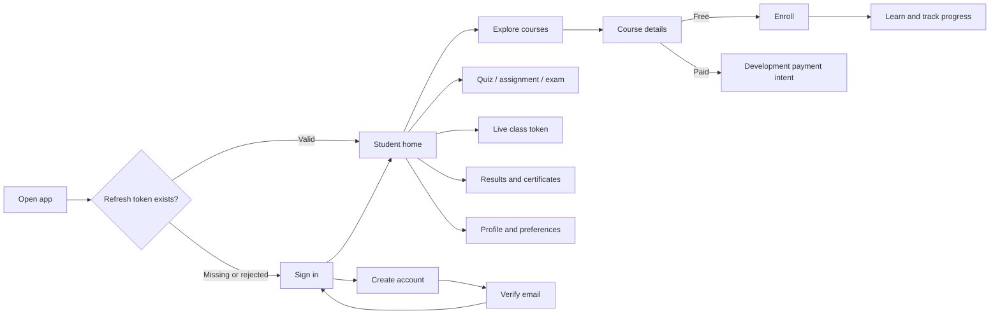

# Product and user journeys

## 1. Product scope

Shikhon is a student-first LMS client for Bangladeshi learners. The product
language defaults to Bengali, with a complete English catalog available at
runtime. The Flutter project targets Android, iOS, web, macOS, and Linux, while
the current interaction design is primarily mobile-oriented.

### Primary user

The implemented interface is for a learner with a `student` role. The learner
can authenticate, discover and enroll in courses, learn from course materials,
complete activities, and review academic records.

### Secondary roles

Teacher and administrator operations are represented in the typed API client,
but there are no teacher or administrator screens, controllers, navigation
guards, or role-specific shells. They are contract-only in this app.

## 2. Journey overview

## 3. Authentication journeys

### 3.1 Returning learner and session restoration

1. The app opens at `/` and displays the splash screen.
2. `AuthController.restoreSession()` asks the authentication repository to
   restore the session.
3. Live mode reads the refresh token from secure storage. The access token is
   not persisted.
4. The refresh token is exchanged for a new rotating token pair.
5. The app requests the current profile and considers only an `active` user
   authenticated.
6. Success routes to `/home`; a missing, expired, or rejected refresh token
   routes to `/sign-in`.
7. A non-authentication network failure is shown through controller error state,
   but the splash still routes to sign-in because restoration returned false.

### 3.2 Sign in

1. The learner enters an email and password.
2. Client validation requires a syntactically valid email and a non-empty
   password.
3. “Remember email” persists only the email address in `SharedPreferences`.
4. The live repository calls login, securely saves the returned refresh token,
   retains the access token in memory, and requests the authenticated user.
5. Active users enter the five-tab student shell. Non-active users remain at
   sign-in with an email-verification message.

In mock mode, any valid-looking email and any non-empty password create a local
preview student. Mock mode does not persist a session.

### 3.3 Registration and email verification

1. The learner supplies a name, email, password, matching confirmation, and
   accepts the terms checkbox.
2. The name must have at least 2 trimmed characters. The password must have at
   least 12 characters, matching the API schema.
3. Registration creates a pending user and may return a verification token.
4. The app routes to `/verify-email`, passing the email address.
5. The learner manually enters or pastes the verification token. In preview
   mode a development token is available through the mock response.
6. Successful verification returns the learner to sign-in.
7. The learner can request another verification message using the email passed
   into the page.

There is no mobile deep-link handler for verification links in the current
codebase.

### 3.4 Forgotten and reset password

1. From sign-in, the learner opens `/forgot-password` and submits an email.
2. The API intentionally returns a non-enumerating recovery response.
3. A learner who already has a reset token opens `/reset-password`.
4. The page requires a token, a new password of at least 12 characters, and a
   matching confirmation.
5. Success clears the navigation stack and returns to sign-in.

There is no password-reset deep-link parser; the token is entered manually.

### 3.5 Change password and sign out

- Change password requires the current password and a 12-character new
  password. A successful server update clears the stored tokens. The page then
  returns to sign-in.
- Sign out attempts server-side refresh-token revocation and always removes the
  local token pair. A server `401` during logout is treated as already logged
  out.

## 4. Student shell and primary navigation

`HomeShell` is an `IndexedStack`, so the state of each tab remains alive while
the learner changes tabs. It has five destinations:

| Tab | Page | Main purpose |
| --- | --- | --- |
| Home | `HomePage` | Dashboard aggregate, continue learning, next live class, today’s tasks, recommendations |
| Explore | `CoursesPage` | Search and filter the public course catalog |
| Learning | `LearningPage` | Enrolled courses and learning progress |
| Results | `ResultsPage(embedded: true)` | Quiz, assignment, and completion results |
| Profile | `ProfilePage` | Account, certificates, language, theme, password, and sign-out |

Entering the shell triggers course loading and student-data loading in parallel.
Student data itself loads dashboard, enrollments, results, certificates,
notifications, and unread count concurrently. A partial failure preserves
successful sections and records the first error.

## 5. Home journey

The home screen consumes the aggregate student dashboard when available:

- The first `continue_learning` item links to course details.
- The first upcoming live class links to the live room token flow.
- The first due assignment and available quiz become “today’s tasks.”
- Recommended courses populate the horizontal course list.
- The notification action opens the notification center and can show the unread
  count maintained by `StudentLmsController`.

If the dashboard lacks a section, the UI falls back to loaded enrollments or
courses where appropriate, then to localized empty states. Backend-authored
titles and descriptions are displayed in the language returned by the API.

## 6. Course discovery, enrollment, and payment

### 6.1 Explore courses

1. The learner searches locally while typing by title, subject, or instructor.
2. Submitting the search also requests the server-side query.
3. Category chips filter All, SSC, HSC, Admission, and Medical results.
4. The page provides loading placeholders, an API error/retry state, and a
   no-results state.
5. Selecting a course passes its `Course` object to `/course-details`.

The repository follows cursor pagination until no next cursor remains. Course
lists are requested in pages of 100.

### 6.2 Course details

1. The page refreshes details by course slug and maps modules and lessons into
   the app domain model.
2. It shows metadata, overview, curriculum, price, and module expansion.
3. Sharing currently copies only the course slug to the clipboard.
4. Bookmarking shows a “not available” message; no saved-course mutation runs.
5. Preview lessons can be opened without enrollment. Locked lessons ask the
   learner to enroll first.

### 6.3 Free course

1. The learner selects enroll.
2. The API creates the enrollment.
3. Student data is reloaded.
4. The course is refetched with its enrollment ID and opens in the lesson page.

### 6.4 Paid course

1. The learner enters `/payments` with the selected course.
2. The app creates an order using a per-request mobile idempotency key.
3. It creates a payment intent.
4. The current backend response is explicitly a development/dummy provider.
5. The app does not open a gateway, collect money, or treat intent creation as
   payment confirmation or enrollment.

Payment history is separately loaded from the student payments endpoint.

## 7. Learning journey

### 7.1 My learning

The Learning tab lists active enrollments, renders progress, and links to course
details. Pull-to-refresh reloads the combined student dataset. Weekly streak and
goal presentation are currently UI-level presentation rather than a dedicated
analytics write flow.

### 7.2 Lesson player and progress

1. The lesson page flattens published lessons across all course modules.
2. The first published lesson is selected by default.
3. A video lesson with `media_asset_id` requests typed playback metadata and
   initializes `video_player` with the signed URL.
4. Non-video private media can be opened through a short-lived access URL in an
   external application.
5. Progress is reported every 45 seconds for an enrolled course.
6. Each watched-seconds delta is clamped to the backend maximum of 120 seconds.
7. Progress is also reported when playback pauses, the selected lesson changes,
   the app becomes inactive, or the page closes.
8. “Complete lesson” sends a manual-completion update with the current position.

Progress reporting is deliberately best effort: lifecycle/disposal errors are
swallowed and the next scheduled report can retry with the next position.

## 8. Assessment journeys

The assessment index loads quizzes, assignments, and exams in parallel and
shows independent sections with counts, empty states, and refresh/retry support.

### 8.1 Quiz

1. Selecting a quiz starts a server-owned attempt and receives a question
   snapshot without answer keys.
2. Single-choice and multiple-choice selections are saved immediately.
3. Short answers are saved when moving between questions or submitting.
4. A countdown is derived from `expires_at`. Expiry auto-submits the attempt.
5. Manual submission requires confirmation.
6. The result dialog shows passed/completed status and percentage when the
   backend returns it.
7. Back navigation is intercepted and requires exit confirmation.

### 8.2 Admission exam / model test

The exam journey mirrors quiz autosave and navigation but uses distinct exam
attempt endpoints, respects `submit_before` before falling back to `expires_at`,
and uses the exam submission result. The API contract also exposes negative
marking, sections, leaderboard, and analytics data where returned; the current
attempt UI focuses on answering and final percentage.

### 8.3 Assignment

1. The assignment list supplies the selected assignment ID.
2. The submission page accepts text, one file, or both.
3. Allowed chooser extensions are PDF, PNG, JPG/JPEG, DOC, and DOCX.
4. A file is read into memory, then an upload intent is created.
5. The bytes are uploaded to the presigned URL with a separate Dio client that
   has no LMS bearer-token interceptor.
6. The upload is completed, producing a media asset ID.
7. The app creates a draft submission and then submits it.

The page does not load assignment title, instructions, deadline, or server-side
file constraints. It identifies the task by ID and is therefore only partially
complete as a learner experience.

## 9. Live class journey

1. The live-class list loads server-owned student live sessions.
2. Ended and cancelled sessions cannot be opened.
3. Selecting an available session requests a short-lived LiveKit URL, token, and
   expiry.
4. The page confirms credentials are ready but does not render a video room.

LiveKit SDK integration is required to turn this into an actual live classroom.
Credentials are neither logged nor persisted by the app.

## 10. Results, certificates, and notifications

### Results

The Results tab consumes the student results list and presents course-level quiz,
assignment, completion, and summary data. It supports pull-to-refresh, loading,
empty, and retry states.

### Certificates

- The learner can list earned certificates.
- Download requests expect a `302` response and open the `Location` URL in an
  external application.
- Certificate verification accepts a public certificate number and displays
  valid/invalid status plus learner, course, organization, and certificate data.

### Notifications

- The notification center lists cursor-paginated notifications.
- Opening an unread item marks it read on the server and updates local state.
- “Mark all read” updates both server and local state.
- The unread count comes from the dashboard and the dedicated count endpoint.
- Notification preferences and device-token endpoints are contract-only; push
  registration is not wired into the UI.

## 11. Profile and preferences

The profile page provides:

- Display of the authenticated learner’s name and email.
- Editing display name, first name, last name, phone, and biography.
- Certificate list and public verification.
- Results/analytics shortcut.
- Light/dark theme toggle, persisted locally.
- Bengali/English selector, persisted locally.
- Notification center and change-password link.
- Sign out.

Profile updates currently always send timezone `Asia/Dhaka` and locale `bn-BD`,
regardless of the app’s selected display language. Avatar, academic preferences,
saved courses, help content, and notification preferences are not active profile
workflows.

## 12. Complete named-route inventory

| Route | Page | Required argument | Status |
| --- | --- | --- | --- |
| `/` | Splash | None | Implemented |
| `/sign-in` | Sign in | None | Implemented |
| `/sign-up` | Registration | None | Implemented |
| `/forgot-password` | Forgot password | None | Implemented |
| `/reset-password` | Reset password | Optional initial token string | Implemented; manual token |
| `/verify-email` | Verify email | Email string | Implemented; manual token |
| `/change-password` | Change password | None | Implemented |
| `/edit-profile` | Edit profile | None | Partially implemented |
| `/home` | Five-tab student shell | None | Implemented |
| `/course-details` | Course details | `Course` | Implemented |
| `/lesson` | Lesson player | `Course` | Implemented with media boundary |
| `/assessments` | Assessment index | None | Implemented |
| `/quiz` | Quiz attempt | Quiz ID string | Implemented |
| `/exam` | Exam attempt | Exam ID string | Implemented |
| `/assignment` | Assignment submission | Assignment ID string | Partially implemented |
| `/live-classes` | Live classes | None | Implemented |
| `/live-room` | Live credential page | Live class ID string | Partial; no room renderer |
| `/payments` | Checkout/history | Optional `Course` | Partial; dummy provider |
| `/results` | Results | None | Implemented |
| `/notifications` | Notification center | None | Implemented |
| `/certificates` | Certificates | None | Implemented |
| `/verify-certificate` | Certificate verification | None | Implemented |

All named routes use a short fade-and-slide transition. Missing `Course`
arguments render a localized missing-course page. Unknown routes render a
page-not-found screen with a route back to sign-in.

## 13. QA journey checklist

For release testing, exercise at least these paths:

1. Cold start with no token, valid token, expired token, and offline API.
2. Register, resend verification, verify, sign in, change password, and sign out.
3. Remembered-email on/off behavior without password persistence.
4. Bengali/English and light/dark persistence across restart.
5. Empty, partial-error, and populated dashboard data.
6. Course search/filter, free enrollment, locked lesson, and preview lesson.
7. Video playback, lifecycle pause, periodic progress, manual completion, and
   media URL failure.
8. Quiz/exam single, multiple, and text answers; autosave failure; timer expiry;
   manual submit; and exit confirmation.
9. Assignment text-only, file-only, upload failure, creation failure, and final
   submission failure.
10. Live-class scheduled/live/ended/cancelled states and token failure.
11. Notification read/read-all, certificate download redirect, verification,
    and payment-history empty/error states.
